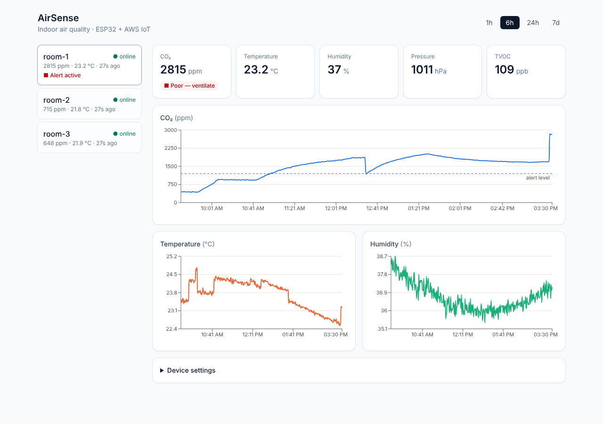
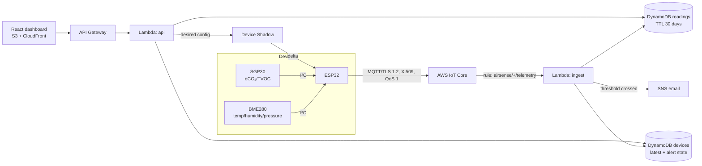

# AirSense — IoT Indoor Air-Quality Monitor

An ESP32 with two sensors measures **temperature, humidity, pressure, CO₂ and TVOC**, sends
readings securely to **AWS IoT Core**, and a live **React dashboard** shows trends. When a room gets
stuffy (CO₂ above the alert level) you get an **email alert**, and the board's LED lights up.
Thresholds and reporting interval can be changed from the dashboard and reach the device over the air.


<sub>Screenshot from the included simulator (3 rooms, room-1 crowded). Replace with your hardware's data.</sub>

**Skills:** embedded C++ (ESP32, I²C sensors, FreeRTOS watchdog, NVS flash) · MQTT over mutual-TLS ·
AWS IoT Core (things, X.509 certs, policies, rules, Device Shadow) · Lambda (Python) · DynamoDB ·
API Gateway · SNS · S3 + CloudFront · Terraform · React + TypeScript · pytest/moto · GitHub Actions

## Architecture



## Hardware (~$20)

| Part | Notes |
|---|---|
| ESP32 DevKit V1 (ESP-WROOM-32) | Wi-Fi microcontroller |
| BME280 breakout (I²C) | Temperature, humidity, pressure. Make sure it's BM**E**, not BMP |
| SGP30 breakout (I²C) | eCO₂ (equivalent CO₂) and TVOC. Needs ~15 s warm-up, ~12 h to fully calibrate |
| Breadboard + jumper wires, USB cable | |

**Wiring** (both sensors share the I²C bus):

| Sensor pin | ESP32 pin |
|---|---|
| VIN / VCC | 3V3 |
| GND | GND |
| SDA | GPIO 21 |
| SCL | GPIO 22 |

## Engineering highlights

| Problem | Solution |
|---|---|
| Wi-Fi drops lose data | Readings go into a fixed-size ring buffer (1 h, no heap allocation) and are removed **only after the broker acknowledges them** (MQTT QoS 1). Flushed oldest-first on reconnect. |
| Many devices reconnecting at once | Exponential backoff with cap and ±20% jitter (unit-tested). |
| Firmware hang | Hardware task watchdog reboots the board after 60 s. |
| Sensor accuracy | SGP30 gets humidity compensation from the BME280 (absolute humidity computed on-device); its calibration baseline is saved to flash hourly and restored on boot; EMA smoothing; impossible values (loose wire, I²C glitch) are dropped. |
| Device security | One X.509 certificate per device; the IoT policy uses `${iot:Connection.Thing.ThingName}` so a device can only connect as itself and publish to its own topic. The ingest Lambda also checks the payload's device ID matches the MQTT topic. |
| Out-of-order data | Buffered readings arrive late after a reconnect: history stores everything (idempotent keys), but "latest" only moves forward (DynamoDB conditional write). Old readings never trigger alerts. |
| Alert spam / duplicates | Alerts fire on state **transitions** only, with hysteresis (must drop 100 ppm below the limit to clear), via a conditional write so concurrent Lambdas can't both send. If SNS fails, the state is rolled back so the automatic retry re-sends. |
| Long chart ranges | API paginates DynamoDB and downsamples to ≤ 360 points, keeping each bucket's CO₂ max so spikes aren't averaged away. |
| Remote config | Dashboard → API (admin token, constant-time compare) → Device Shadow `desired` → device gets the delta, validates ranges, saves to flash, reports back. |
| Cost | Everything is serverless/pay-per-request: a few devices cost ~$1/month. Readings expire after 30 days (DynamoDB TTL). |

## Tests

| Suite | What | Count |
|---|---|---|
| `make -C firmware test` | Ring buffer, JSON serialisation, CO₂ bands, plausibility, backoff, EMA (native g++) | 5 suites |
| `cd cloud && pytest` | Ingest validation, out-of-order data, alert hysteresis, SNS-failure retry, API pagination/downsampling, auth, shadow updates (moto-mocked AWS) | 26 |
| `cd web && npm test` | Dashboard rendering, alert display, config form + auth errors, API-down state | 6 |
| CI | All of the above + **PlatformIO compiles the ESP32 firmware** + `terraform validate` | |

## Try it without hardware or AWS (5 minutes)

```bash
pip install -r tools/requirements.txt
python tools/local_api.py                                    # runs the real Lambda code locally (moto)
python tools/simulate.py --local --devices 3 --backfill-hours 6 --crowded   # 2nd terminal
cd web && npm install && npm run dev                         # 3rd terminal → http://localhost:5173
```
Watch the first terminal print the alert email when room-1's CO₂ crosses 1200 ppm. Admin token
for the settings form: `local-admin`.

## Deploy to AWS

```bash
cd infra/terraform
cp terraform.tfvars.example terraform.tfvars     # your email, device names
terraform init && terraform apply                # confirm the SNS email AWS sends you
terraform output -json > ../../outputs.json && cd ../..
python tools/make_secrets.py outputs.json --device airsense-01 --wifi-ssid "YourWiFi" --wifi-password "..."
rm outputs.json                                  # contains private keys

# dashboard
cd web && echo "VITE_API_URL=$(terraform -chdir=../infra/terraform output -raw api_url)" > .env.production
npm run build && aws s3 sync dist s3://$(terraform -chdir=../infra/terraform output -raw web_bucket) --delete
```

## Flash the ESP32

```bash
pip install platformio
cd firmware && pio run -e esp32dev -t upload && pio device monitor
```
You should see `[sensors] BME280 ok, SGP30 ok`, then `[mqtt] connected`. No hardware yet? The
simulator can publish to the real AWS IoT endpoint with the generated certificate:
`python tools/simulate.py --endpoint <iot_endpoint> --cert certs/airsense-01.pem.crt --key certs/airsense-01.private.pem.key --ca certs/AmazonRootCA1.pem --device airsense-01`

## Results

> Fill in from your own build: e.g. "ran 7 days, N readings, X% delivered, alert latency Y s
> (CO₂ crossing → email), offline buffer recovered Z readings after a router reboot".
